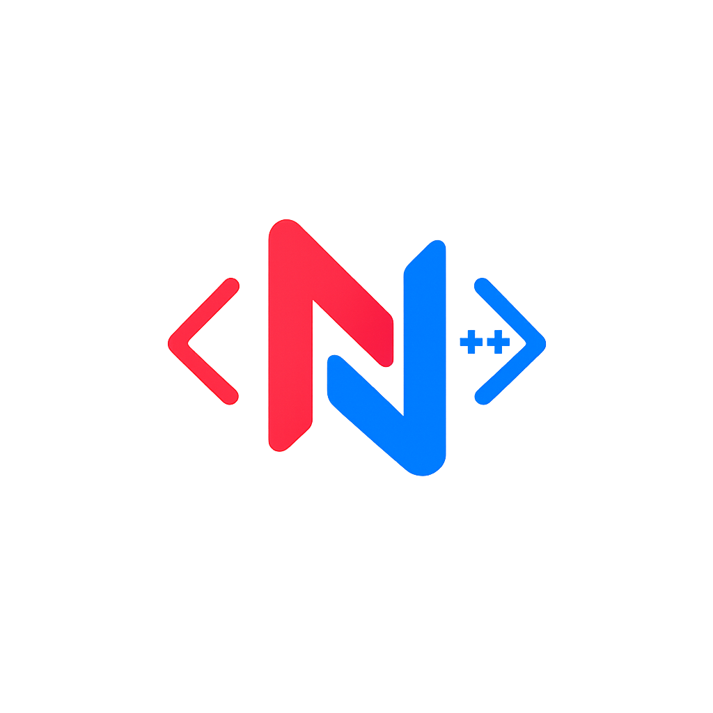

<div align="center">
  
  
  <h1>NovaCPP</h1>
  
  <p>
    <a href="https://github.com/CfRadar/NovaCPP/blob/main/LICENSE"></a>
    <a href="#"></a>
    <a href="#"></a>
    <a href="https://github.com/CfRadar/NovaCPP/pulls"></a>
  </p>
</div>

NovaCPP is a high-performance C++ web framework designed to build responsive, interactive user interfaces with **C++ execution speed** and **modern React-like developer ergonomics**.

* **Declarative & Component-Based:** Build encapsulated components in standard C++ that manage their own state and surgically update only changed DOM nodes.
* **Full-Stack Monolith (No-API):** Write your UI layouts, business logic, and database operations in a single C++ executable. No JSON REST serialization overhead.
* **Instant Fast Refresh HMR:** Incremental ~1s C++ recompilation pushed directly over Server-Sent Events without resetting state.
* **Standard npm Packages:** Install standard packages with `npm i <package>` and import them directly in the browser via automated `esbuild` pre-bundling.

---

## 30-Second Quickstart

Bootstrap a new project instantly using `npx create-novacpp`:

```bash
npx create-novacpp@latest my-app
cd my-app

# Launch the hot reloading development runner
npm run dev
# OR on Windows PowerShell
.\nova dev
```

Open [http://localhost:8080](http://localhost:8080) to experience the live animated starter showcase.

---

## Interactive Example

```cpp
#include "novacpp/html.hpp"
#include "novacpp/state.hpp"

// 1. Thread-safe session-isolated reactive state
np::State<int> counter(0);

void renderApp(np::NovaBuilder& np) {
    // 2. Direct C++ callback for button click
    np.onClick("increment", []() {
        counter = counter.get() + 1;
    });

    // 3. Declarative UI stream
    np << "<div class='bento-card col-4'>"
       << "    <h1>Counter: " + std::to_string(counter.get()) + "</h1>"
       << "    <button class='btn btn-primary' nova-click='increment'>+ Increment</button>"
       << "</div>";
}
```

---

## Documentation Sections

Explore the dedicated documentation chapters below on the [Nova Documentation Site](https://nova-documentation.vercel.app/) for complete guides, architecture explanations, and in-depth code examples:

### 🚀 [Getting Started](https://nova-documentation.vercel.app/learn/getting-started/introduction)
* [Introduction & Philosophy](https://nova-documentation.vercel.app/learn/getting-started/introduction) — The "No-API" paradigm and core framework pillars.
* [Installation & Quickstart](https://nova-documentation.vercel.app/learn/getting-started/installation) — Prerequisites, CLI scaffolding, project structure, and production builds.
* [Interactive Examples](https://nova-documentation.vercel.app/learn/getting-started/interactive-examples) — Walkthrough of the reactive counter, live clock, REST fetch engine, and npm confetti.

### 🎨 [Describing the UI](https://nova-documentation.vercel.app/learn/describing-the-ui)
* [Your First Component](https://nova-documentation.vercel.app/learn/describing-the-ui/your-first-component) — Creating and inheriting `np::Component`.
* [Writing Code in C++](https://nova-documentation.vercel.app/learn/describing-the-ui/writing-code-in-cpp) — Dynamic HTML rendering using standard C++ logic.
* [Passing Components](https://nova-documentation.vercel.app/learn/describing-the-ui/passing-components) — Passing data and references between components.
* [Rendering Individual Components](https://nova-documentation.vercel.app/learn/describing-the-ui/rendering-individual-components) — Invoking `renderComponent()` and the Component Lifetime Invariant.
* [Making a Tree](https://nova-documentation.vercel.app/learn/describing-the-ui/making-a-tree) — Composing hierarchical UI trees.
* [Making a Dice Game](https://nova-documentation.vercel.app/learn/describing-the-ui/making-a-dice-game) — Building a complete interactive game.
* [Frontend HTML Directives](https://nova-documentation.vercel.app/learn/describing-the-ui/frontend-html-directives) — Deep dive into `nova-link`, `nova-click`, `nova-target`, and `nova-poll`.
* [Styling & Bento Grid](https://nova-documentation.vercel.app/learn/describing-the-ui/styling-and-bento-grid) — Mathematical 12-column bento system, pastel badges, and grid canvas.
* [Theming & 3D Code Flip](https://nova-documentation.vercel.app/learn/describing-the-ui/theming-and-animations) — Light/Dark theme tokens, 1-click switcher, and 3D component inspection cards.
* [Using npm Packages](https://nova-documentation.vercel.app/learn/describing-the-ui/using-npm-packages) — Pre-bundling npm modules via `esbuild` and browser import maps.

### ⚡ [Understanding the Backend](https://nova-documentation.vercel.app/learn/understanding-the-backend)
* [The Monolith Architecture](https://nova-documentation.vercel.app/learn/understanding-the-backend/the-monolith-architecture) — Shared memory space between views and business logic.
* [Routing & main.cpp](https://nova-documentation.vercel.app/learn/understanding-the-backend/routing-and-main) — Setting up SPA routes and booting the HTTP server.
* [Server-Side State](https://nova-documentation.vercel.app/learn/understanding-the-backend/server-side-state) — Multi-session isolation via `nova_session` cookies.
* [Live Background Polling](https://nova-documentation.vercel.app/learn/understanding-the-backend/live-background-polling) — Pushless real-time data streaming without WebSockets.
* [Native HTTP Client (np::fetch)](https://nova-documentation.vercel.app/learn/understanding-the-backend/native-http-client) — Calling REST APIs with dual WinHTTP and OpenSSL engines.
* [Database Integration](https://nova-documentation.vercel.app/learn/understanding-the-backend/database-integration) — Connecting to SQLite, PostgreSQL, and native storage.
* [Hot Reloading & Fast Refresh](https://nova-documentation.vercel.app/learn/understanding-the-backend/hot-reloading-and-hmr) — Incremental ~1s C++ compiler and SSE push stream.
* [Cloud Deployment Guide](https://nova-documentation.vercel.app/learn/understanding-the-backend/cloud-deployment-guide) — Docker multi-stage deployment to Railway, Render, and Fly.io.

### 📖 [API Reference](https://nova-documentation.vercel.app/learn/api-reference/novabuilder)
* [`np::NovaBuilder`](https://nova-documentation.vercel.app/learn/api-reference/novabuilder) — Route registration, event handlers, and server lifecycle.
* [`np::Component`](https://nova-documentation.vercel.app/learn/api-reference/component) — Base class, constructor ID binding, and virtual `render()`.
* [`np::State<T>`](https://nova-documentation.vercel.app/learn/api-reference/state) — Thread-safe reactive state variables and operators.
* [`np::fetch`](https://nova-documentation.vercel.app/learn/api-reference/fetch) — Native cross-platform HTTP client functions and headers.

---

## Contributing

Development of NovaCPP happens in the open on GitHub. Pull requests, bug reports, and suggestions are warmly welcome!

---

## License

NovaCPP is [MIT licensed](LICENSE).
