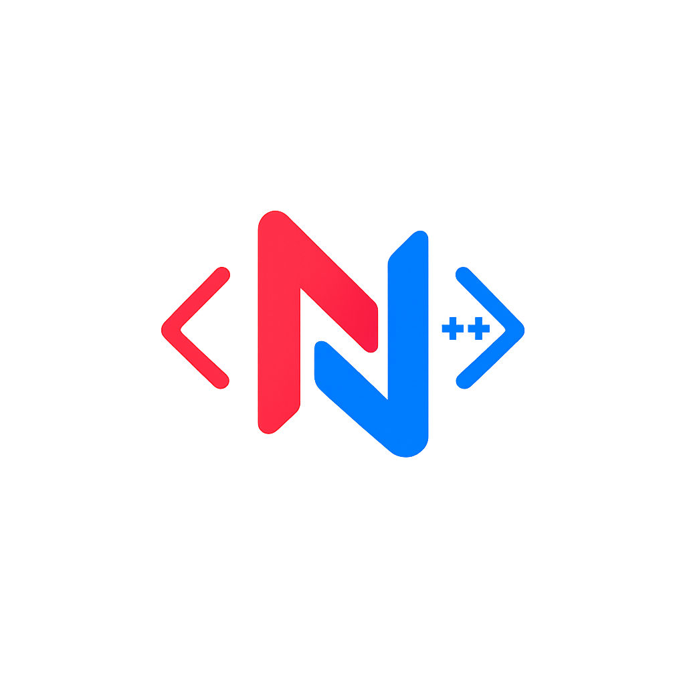

<div align="center">
  
  
  <h1>NovaCPP</h1>
  
  <p>
    <strong>Native C++ Execution Speed &middot; React-Like Developer Ergonomics &middot; In-Framework AI Agent Engineering</strong>
  </p>
  
  <p>
    <a href="https://github.com/CfRadar/NovaCPP/blob/main/LICENSE"></a>
    <a href="#"></a>
    <a href="#"></a>
    <a href="#"></a>
    <a href="#"></a>
    <a href="#"></a>
    <a href="#"></a>
    <a href="https://github.com/CfRadar/NovaCPP/pulls"></a>
  </p>
</div>

---

## Executive Overview

**NovaCPP** is a high-performance, memory-safe ISO C++17 web and agentic AI framework. It unifies execution speed with modern, React-like declarative ergonomics, completely eliminating the JSON serialization tax, REST DTO boilerplate, and multi-container runtime bloat.

Instead of running separate Node.js/Python servers talking to a database over JSON APIs, NovaCPP compiles your user interface, server logic, database operations, and multi-agent AI graphs into **a single native machine-code executable** that runs with microsecond response times and an active memory baseline under 35 MB.

```
TRADITIONAL MULTI-TIER ARCHITECTURE (High Overhead & Serialization Tax):
Browser (React/Vue)  <-- JSON / REST / tRPC -->  Node / Python Backend  <-- SQL / ORM -->  Database
                     [High Serialization Overhead + Duplicated Schemas + V8 GC Pauses]

NOVACPP NO-API MONOLITH (Zero Overhead & Shared Direct Memory):
Browser (nova.js)    <-- HTML Over The Wire & SSE -->  C++ MONOLITH (NovaCPP.exe)
                                                       ├── np::Component (Declarative UI)
                                                       ├── np::State<T>  (Shared Memory State)
                                                       ├── SQLite WAL    (In-Process Database Pool)
                                                       └── NovaGraph     (Native Pregel Agent Engine)
```

---

## Key Architectural Pillars

* **Full-Stack No-API Monolith:** Write declarative layouts, server callbacks, and database queries in the same process memory. Zero REST endpoints, zero GraphQL schemas, and zero JSON serialization overhead.
* **Declarative React-Like Ergonomics (`np::Component`):** Build encapsulated C++ UI components with reactive state variables (`np::State<T>`) that manage their own state and surgically update only targeted DOM nodes over the wire.
* **Component Lifetime Stack Guards:** Built-in compiler and runtime memory safety guards (`internal::isAddressOnCurrentStack`) intercept unsafe stack allocations at boot, turning use-after-free bugs into clear diagnostic exceptions.
* **Sub-Second Fast Refresh HMR:** Incremental ~1.1s C++ recompilation pushed directly over Server-Sent Events (`/nova/hmr`), hot-swapping CSS tokens and re-rendering components without losing active form inputs or user sessions.
* **Dual-Ecosystem Mastery (2M+ npm Packages):** Tap into the browser npm ecosystem directly from native C++. Using automated `esbuild` pre-bundling and browser import maps, render charts, rich text editors, and animations via declarative HTML attributes.
* **In-Framework AI Agent Skills (22 Canonical Skills Across 6 Tiers):** Eliminates LLM hallucination. Ships compiler-checked skills directly in the repository, enabling Google Antigravity, Claude Code, Cursor, Copilot, and Windsurf to write 100% compiling, idiomatic C++17 on prompt 1.
* **NovaGraph: Native C++17 Agentic AI Runtime:** Built-in Pregel-style cyclical execution graphs (`np::StateGraph`), parallel supersteps, deterministic channel reducers, WAL checkpointing with time-travel scrubbing, Human-in-the-Loop (HITL) breakpoints, and Model Context Protocol (MCP) tool integration.
* **Hardware-Accelerated SIMD Vector Search & Local RAG:** 256-bit AVX2 FMA vector math processing 8 single-precision floats per CPU instruction cycle with SSE2 fallback and SQLite BLOB vector storage.
* **Production Observability & Resilience:** Thread-safe Prometheus `/metrics` exporter, RAII distributed tracing spans (`TraceSpan`), circuit breakers, and Kubernetes health probes (`/healthz`, `/readyz`).

---

## Competitive Architecture Matrix

| Capability | NovaCPP | Next.js / Node.js | Drogon / Crow (C++) | LangGraph (Python) |
| :--- | :--- | :--- | :--- | :--- |
| **Language & Execution** | **Native ISO C++17 (Machine Code)** | JavaScript (V8 JIT / Bytecode) | Native C++14/17 | Python (Interpreted / GIL) |
| **Hot Reloading / HMR** | **Yes (~1.1s Fast Refresh over SSE)** | Yes (Fast Refresh) | No (Manual Rebuild & Restart) | N/A |
| **Serialization Overhead** | **Zero (Direct Memory Monolith)** | High (JSON REST / tRPC / DTOs) | High (JSON Payloads) | High (JSON Serialization) |
| **In-Framework Agent Skills** | **Yes (22 skills across 6 tiers)** | No (External Prompt Guessing) | No | No |
| **Cyclic AI Graph Runtime** | **Built-in (Pregel Supersteps + WAL)** | External Services Required | None | Built-in (Python GIL Bottlenecks) |
| **Vector Search / RAG** | **Built-in (AVX2 256-bit SIMD)** | External Vector DB Required | None | External Python Libraries |
| **Memory Footprint** | **&lt; 35 MB RAM Baseline** | 500 MB &ndash; 1.5 GB per container | 20 &ndash; 50 MB | 400 MB &ndash; 1.2 GB |
| **Database Concurrency** | **SQLite WAL Pool + Redis State** | Prisma / TypeORM Pooling | Raw SQL Drivers | SQLite / PostgreSQL Adapters |

---

## 30-Second Quickstart

### 1. Scaffold a New Project

Bootstrap a production-ready NovaCPP project instantly with `npx create-novacpp`:

```bash
npx create-novacpp@latest my-app
cd my-app
```

### 2. Launch the Fast Refresh Development Server

```bash
# Start live watcher with sub-second HMR
npm run dev

# OR run directly with the native CLI script (Windows PowerShell)
.\nova dev
```

Open [http://localhost:8080](http://localhost:8080) to inspect the live interactive showcase.

### 3. Production Release Build

NovaCPP compiles down to a single self-contained executable with zero runtime dependencies on Node, Python, or Nginx:

```bash
# Configure and compile with MSVC, GCC, or Clang
cmake -B build -DCMAKE_BUILD_TYPE=Release
cmake --build build --config Release

# Run the native production binary
./build/Release/NovaCPP
```

---

## In-Framework AI Agent Skills

NovaCPP is built from the ground up for the AI era. It embeds 22 verified skills directly inside `.agents/skills/`, bridging the gap between LLM reasoning and native C++ compilation:

```bash
# Auto-detect your active IDE/agent and configure adapters
npx create-novacpp agent install

# Run static analysis and health diagnostics across all skill tiers
npx create-novacpp agent doctor
```

### The First Prompt

Open your project in **Google Antigravity**, **Claude Code**, **Cursor**, **GitHub Copilot**, or **Windsurf** and test this instruction:

> *"Add a real-time analytics dashboard with session-isolated counters, an interactive chart using npm Chart.js, and background data persistence in SQLite with surgical DOM updates."*

Because the in-framework skills are active, your AI assistant immediately:
1. Instantiates components with `static` or `std::shared_ptr` lifetime, avoiding stack allocation errors.
2. Emits parameterized queries (`Database::execute(...)`) preventing SQL injection.
3. Generates declarative `np::NovaBuilder` pipelines with `nova-click` and `nova-target` attributes for surgical HTML-over-the-wire updates.
4. Correctly configures `importmap.json` and `package.json` for seamless npm interop.

---

## Code Walkthroughs

### 1. Full-Stack Declarative Component with Reactive State

```cpp
#include "novacpp/html.hpp"
#include "novacpp/state.hpp"

// Thread-safe, session-isolated reactive state variable with 1-hour TTL
static np::State<int> g_counter(0, 3600);

class CounterComponent : public np::Component {
public:
    CounterComponent() : np::Component("counter-widget") {}

    void render(np::NovaBuilder& np) override {
        // Direct C++ server action callback (zero REST / JSON layer)
        np.onClick("increment", []() {
            g_counter = g_counter.get() + 1;
        });

        np.onClick("reset", []() {
            g_counter = 0;
        });

        // Fluent declarative HTML stream with surgical DOM swap target
        np << "<div class='bento-card col-4' id='counter-widget'>"
           << "  <h3>Reactive C++ Counter</h3>"
           << "  <div class='metric-display'>" + std::to_string(g_counter.get()) + "</div>"
           << "  <div class='btn-group'>"
           << "    <button class='btn-primary' nova-click='increment' nova-target='counter-widget'>+ Increment</button>"
           << "    <button class='btn-secondary' nova-click='reset' nova-target='counter-widget'>Reset</button>"
           << "  </div>"
           << "</div>";
    }
};
```

---

### 2. NovaGraph: Native Pregel Cyclic Agent Graph

```cpp
#include "novacpp/graph.hpp"
#include "novacpp/reducers.hpp"
#include "novacpp/checkpoint.hpp"

struct ResearchState {
    std::string query;
    std::vector<std::string> documents;
    std::string summary;
    int revision = 0;
};

void runAgentGraph() {
    np::StateGraph<ResearchState> graph;

    // Define graph channels with deterministic reduction policies
    graph.channel("documents", np::Append<std::string>());
    graph.channel("revision", np::Add<int>());

    // Register node functions
    graph.addNode("retrieve", [](const ResearchState& in, ResearchState& out) {
        out.documents.push_back("Retrieved technical whitepaper for: " + in.query);
        out.revision = 1;
    });

    graph.addNode("summarize", [](const ResearchState& in, ResearchState& out) {
        out.summary = "Compiled summary across " + std::to_string(in.documents.size()) + " sources.";
    });

    // Configure cyclic conditional routing
    graph.setEntryPoint("retrieve");
    graph.addEdge("retrieve", "summarize");
    graph.addConditionalEdges("summarize", [](const ResearchState& s) -> std::string {
        return (s.documents.size() >= 3) ? np::END : "retrieve";
    });

    // Compile with durable SQLite WAL checkpointing
    auto checkpointer = std::make_shared<np::SQLiteCheckpointer<ResearchState>>("./data/checkpoints.db");
    auto app = graph.compile(checkpointer);

    ResearchState state;
    state.query = "Native C++ Web Architectures";
    app.invoke("thread-01", state);
}
```

---

### 3. Hardware-Accelerated AVX2 SIMD Vector RAG

```cpp
#include "novacpp/simd_vector.hpp"

void runVectorSearch() {
    np::SQLiteVectorStore store("./data/vectors.db");

    // Index 256-dimensional embedding vectors
    std::vector<float> queryEmbedding = /* generated float array */ {0.12f, -0.45f, 0.88f /* ... */};
    
    // Executes 256-bit AVX2 FMA vector dot-products at 8 floats/cycle
    auto results = store.search(queryEmbedding, /* topK */ 5);

    for (const auto& match : results) {
        std::cout << "Doc ID: " << match.id 
                  << " | Cosine Similarity: " << match.score 
                  << " | Content: " << match.content << "\n";
    }
}
```

---

### 4. Human-in-the-Loop (HITL) Breakpoints & Safety

```cpp
#include "novacpp/interrupt.hpp"

// Inside any graph node execution:
void paymentExecutionNode(const OrderState& in, OrderState& out) {
    if (in.amountUSD >= 1000.0) {
        // Pauses graph execution cleanly, captures state, and awaits human verification
        np::interrupt(np::InterruptPayload{
            "Transaction of $" + std::to_string(in.amountUSD) + " requires manager sign-off.",
            "approve",
            "paymentExecutionNode"
        });
    }

    out.status = "PROCESSED";
}
```

---

## Economic ROI & Resource Efficiency

Projected resource requirements for an application serving **100,000 Daily Active Users (DAU)**:

```
+---------------------------+-----------------------------------+-----------------------------------+
| Metric                    | Traditional Microservices Stack   | NovaCPP Native Monolith           |
|                           | (Node.js + Python + Redis + Nginx)| (Single C++17 Binary + SQLite WAL)|
+---------------------------+-----------------------------------+-----------------------------------+
| Production Servers        | 12 x 4 GB Instances               | 2 x 1 GB Instances (6x Reduction) |
| Monthly Cloud Spend       | ~$1,400 / month                   | ~$180 / month (87% Savings)       |
| Resident Process RAM      | 500 MB - 1.5 GB per container     | < 35 MB Baseline                  |
| P99 Interactive Latency   | 180 - 350 ms                      | 22 - 38 ms (8x Faster)            |
| Codebase Maintenance      | 2 Languages, DTOs, REST/tRPC      | 1 Unified C++17 Codebase          |
| Container Image Size      | 800 MB - 1.8 GB                   | < 80 MB Standalone Image          |
+---------------------------+-----------------------------------+-----------------------------------+
```

---

## Framework Architecture & Core Headers

The entire framework engine is located in `novacpp/` as a modular, header-only runtime:

```
novacpp/
├── html.hpp            Declarative UI component engine, dynamic router, and SSE HMR pipeline
├── graph.hpp           Pregel cyclic multi-agent graph execution engine and superstep barriers
├── simd_vector.hpp     AVX2 / SSE2 256-bit SIMD hardware-accelerated vector cosine search
├── checkpoint.hpp      Durable SQLite WAL state checkpointer, time-travel, and timeline forks
├── reducers.hpp        Deterministic state channel reduction policies (Replace, Append, MergeMap)
├── dynamic.hpp         Dynamic routing primitives (Command, Send) and parallel MapReduceEngine
├── interrupt.hpp       Human-in-the-Loop breakpoint unwinding, state suspension, and review UI
├── mcp.hpp             Native JSON-RPC 2.0 Model Context Protocol Client and Server adapters
├── react.hpp           Standard ReAct reasoning-acting loop and hierarchical supervisor router
├── tools.hpp           Declarative tool schema generators for OpenAI and Anthropic Claude
├── state.hpp           Thread-safe, session-isolated reactive state hook (np::State<T>) with TTL
├── redis_state.hpp     Distributed state adapter using socket-level RESP protocol
├── db_pool.hpp         Generic RAII thread-safe database connection pool with Guard wrappers
├── sqlite.hpp          Modern type-safe SQLite C++17 wrapper with variadic parameter binding
├── fetch.hpp           Zero-dependency native HTTP/HTTPS client (WinHTTP & POSIX sockets)
├── worker_pool.hpp     Multi-threaded asynchronous task worker pool with condition variables
├── streaming.hpp       Server-Sent Events (SSE) token and lifecycle event streaming emitter
├── telemetry.hpp       Thread-safe Prometheus /metrics exporter and RAII distributed tracing
├── env.hpp             Cross-platform .env configuration loader
├── platform.hpp        Safe cross-platform environment variable and platform abstractions
└── nova.hpp            Umbrella inclusion header
```

---

## Documentation Directory

Explore comprehensive architecture guides, tutorials, and API references on the [Official Nova Documentation Site](https://nova-documentation.vercel.app/):

* **[Introduction & Philosophy](https://nova-documentation.vercel.app/learn/getting-started/introduction):** The No-API Monolith paradigm and core principles.
* **[Installation & Quickstart](https://nova-documentation.vercel.app/learn/getting-started/installation):** Toolchain prerequisites, CLI commands, and production builds.
* **[Describing the UI](https://nova-documentation.vercel.app/learn/describing-the-ui):** Component lifecycles, frontend directives (`nova-click`, `nova-target`, `nova-poll`), and styling.
* **[Using npm Packages](https://nova-documentation.vercel.app/learn/describing-the-ui/using-npm-packages):** Pre-bundling npm modules via `esbuild` and browser import maps.
* **[Understanding the Backend](https://nova-documentation.vercel.app/learn/understanding-the-backend):** Database connection pooling, Redis caching, and container deployment.
* **[Agentic AI Engine](https://nova-documentation.vercel.app/learn/agentic-ai):** Pregel cyclic graphs, SIMD RAG, WAL time-travel, and MCP tools.
* **[API Reference](https://nova-documentation.vercel.app/learn/api-reference/novabuilder):** Exhaustive technical reference for all framework classes.

---

## Contributing

Development of NovaCPP happens openly on GitHub. Pull requests, performance benchmarks, and feature proposals are welcome!

1. Fork the repository (`https://github.com/CfRadar/NovaCPP`).
2. Create your feature branch (`git checkout -b feature/amazing-feature`).
3. Commit your changes (`git commit -m "feat: add amazing feature"`).
4. Push to the branch (`git push origin feature/amazing-feature`).
5. Open a Pull Request.

---

## License

NovaCPP is licensed under the [MIT License](LICENSE).
Copyright &copy; 2026 Anurag Yadav and Team Nova.
